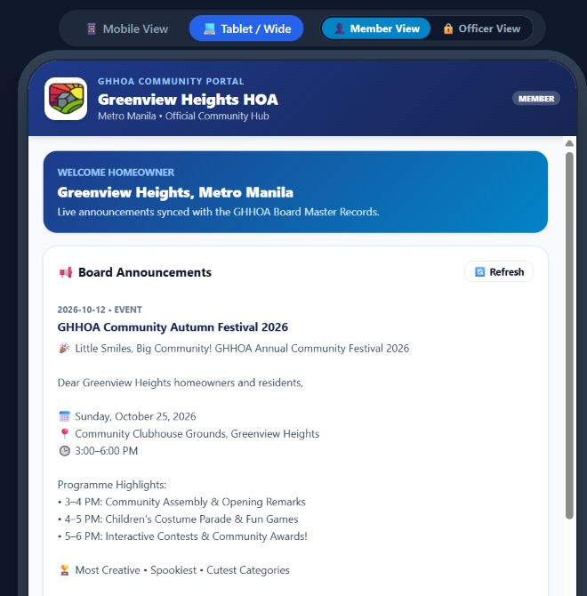
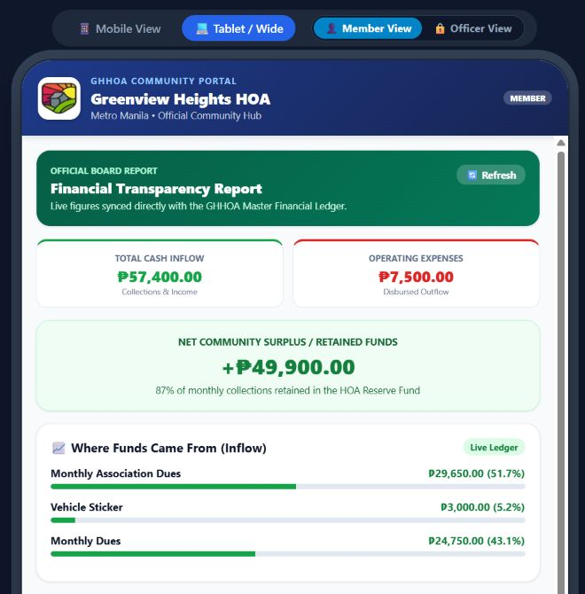
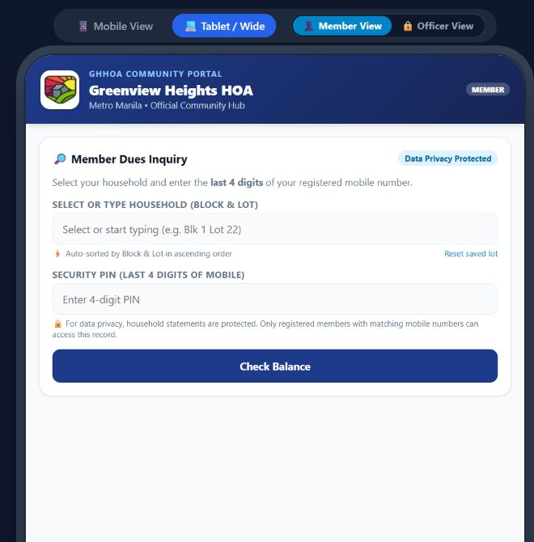

# Willison Goleta

**Operations leader building a career in business intelligence and payments analytics**

📍 Cainta, Rizal, Philippines · [LinkedIn](https://www.linkedin.com/in/willisongoleta) · [Email](mailto:wilson.goleta@gmail.com)

I bring 15+ years of experience across operations, reporting, and process improvement, including payments and Order-to-Cash work. I enjoy turning complex operating data into clear measures and reports that help teams investigate issues and make decisions. My current focus is Power BI, SQL, and analytics roles where I can combine hands-on analysis with business context.

## Featured projects

### Global Payments Performance · Power BI + Power Platform

**A portfolio project using synthetic, illustrative data.** I built a five-page report covering processor performance, payment fees, savings opportunities, network incentives, and processor variance reviews.

The report uses Power Query, a shared-dimension data model, DAX measures, drillthrough, tooltips, synced slicers, and mobile layouts. I also embedded a Power App that saves reviews to Dataverse and built a Power Automate flow that flags high-variance reviews and sends an email alert.

| Report page | Question it helps answer |
| --- | --- |
| Executive Overview | How are the key payment measures trending? |
| Processor Performance | Which processors warrant a closer look at volume, approvals, fees, or invoice variance? |
| Fee Optimization | How do expected and realized savings compare across initiatives? |
| Network Incentives | How does qualifying volume compare with targets, and which records qualify? |
| Processor Reviews | How can a processor variance be recorded, flagged for review, and communicated? |

[Explore the project, screenshots, and build notes](https://github.com/wgoleta/global-payments-performance)

> The report's numbers are illustrative. This project demonstrates my technical approach and is separate from the results of my professional work below.

### Hardware Home Essentials · Looker Studio

An interactive sales and profitability report that combines sales, country, foreign exchange, and purchasing data. It uses data blending, calculated fields, currency conversion, and date and country controls to explore revenue, margin, product, and regional trends.

[View the Looker Studio report](https://datastudio.google.com/reporting/cfb89184-bca7-4478-b4df-3370e567c990/page/Bim8F)

### Greenview Heights HOA Portal · Google Apps Script + Google Sheets

A community portal that brings homeowner announcements, financial reporting, and member dues inquiries into one browser-based app. It provides mobile and tablet views, with announcements and financial summaries connected to Google Sheets.

| Portal view | What it helps users do |
| --- | --- |
| Board Announcements | Read community notices, maintenance updates, and event information. |
| Financial Transparency | Review total collections, operating expenses, retained funds, and category-level inflows and outflows. |
| Member Dues Inquiry | Select a household and enter the last four digits of its registered mobile number to request a balance. |

#### Board announcements

#### Financial transparency dashboard

#### Member dues inquiry

[Open the live HOA portal](https://script.google.com/macros/s/AKfycbyi3BvhA_0hRkMkFhduit0x79MTbgk3OU1_-NzATvOavHLuc8bP3hp4FKeh0JClLQcXBw/exec)

The screenshots show the announcements, aggregate financial dashboard, and blank balance inquiry form. Individual household statements are not included.

## Experience behind the projects

In a payments controls and optimization role, I led analysts monitoring payment fees and network incentives. Our team tracked approximately **$34M in network incentives** and supported initiatives associated with approximately **$2M in annual payment fee savings**. My contribution included guiding the analysis, reviewing findings, establishing recurring reporting, coordinating with stakeholders, and tracking implementation and realized savings. These are professional experience figures, not outputs from the synthetic Power BI project.

## Tools and learning

- **Analytics and automation:** Power BI, DAX, Power Query, Power Apps, Power Automate, Dataverse, Looker Studio, SQL, Excel, Google Sheets, Google Apps Script
- **Business context:** Payments operations, fee analysis, Order-to-Cash, reporting, process improvement
- **Recent learning:** Completed a Coursera Power BI Data Analyst specialization; continuing to practice data modeling, DAX, and project walkthroughs

## Connect

[LinkedIn](https://www.linkedin.com/in/willisongoleta) · [Email](mailto:wilson.goleta@gmail.com)
